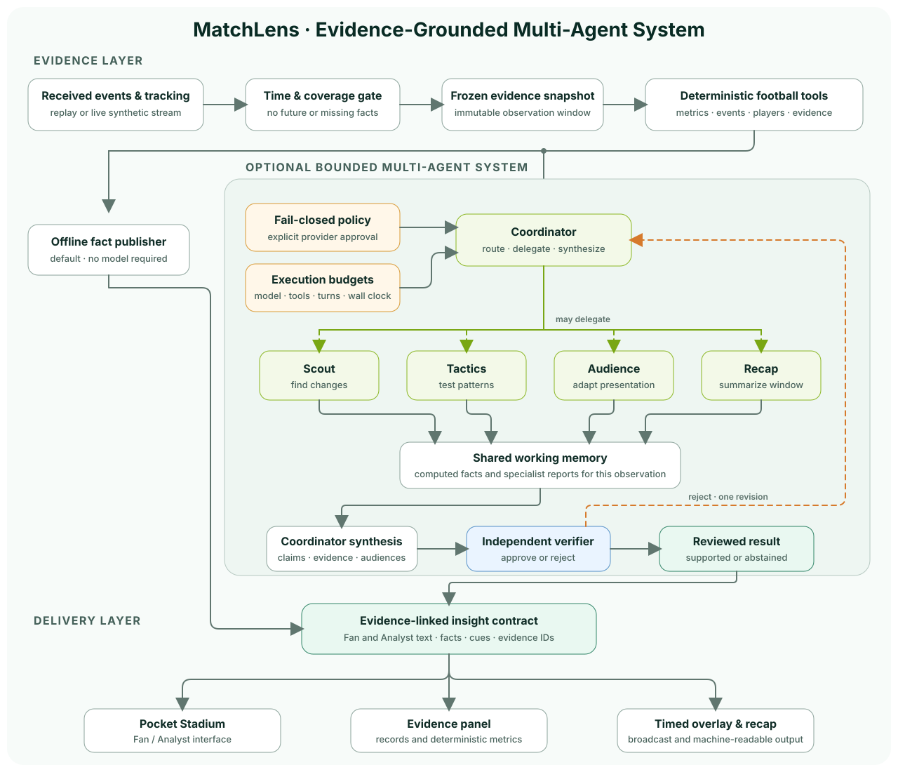

# MatchLens 口袋球场

<p align="center">
  <a href="README.md">English</a> ·
  <strong>简体中文</strong> ·
  <a href="README.fr.md">Français</a> ·
  <a href="README.es.md">Español</a> ·
  <a href="README.ar.md">العربية</a>
</p>

**观看 MatchLens——视频展示离线体验；接入 API 的多 Agent 系统使用同一套界面。**

https://github.com/user-attachments/assets/7c19dc86-b2b1-4d1c-8126-0246e06f65e4

<h3 align="center">
  <a href="https://yuxuanfuture.github.io/MatchLens/">▶ 打开可交互 Demo</a>
</h3>

<p align="center">直接操作视频中的口袋球场：回放比赛、切换受众与语言、自由排列面板。不需要服务器或 API 密钥。</p>

[](https://github.com/yuxuanfuture/MatchLens/actions/workflows/ci.yml)

MatchLens 将已观测到的足球事件转化为带证据引用的解释和个性化微型球场。同一组事实可以成为面向球迷的简明故事、面向分析师的量化背景，以及与时间轴同步的转播图层提示。

## 两种运行方式

MatchLens 是一个可以实际运行的证据与 Agent 框架，而不只是一段预先渲染的产品视频。

| 模式 | 运行内容 |
| --- | --- |
| **离线模式** | 确定性的事件处理、分析、证据、回放、本地化和界面；不需要模型或 API 密钥。 |
| **API 多 Agent 模式** | DeepSeek 或本地 Ollama 驱动 Coordinator 与按需参与的专业角色；确定性工具仍是数字事实来源，独立 Verifier 会审核每个候选结果。 |

两种模式共用冻结的观察窗口、证据契约、口袋球场和过期结果检查。模型可以调查并解释比赛，但不能虚构记录、推进回放时钟或绕过请求预算。

## 为什么需要 MatchLens

足球数据很容易计数，却很难解释。MatchLens 将每一项陈述与支撑它的事件或追踪记录关联，只使用当时可见的信息，并在数据不足时明确表达不确定性，而不是补造事实。

界面可以将同一条证据流适配为 Fan 与 Analyst 模式。默认语言为英语，同时支持简体中文、法语、西班牙语和阿拉伯语，并支持关注球队或球员、可回放的口袋球场和透明转播图层。

## 核心能力

- **证据优先：**解释可以回溯到已接收记录和确定性指标；缺失数据保持缺失，不会被当成零。
- **理解回放：**事件时间与到达时间分开处理，回看时不会提前泄露未来的进球或 VAR 结果。
- **适配受众：**Fan 与 Analyst 模式共享事实，但在语言、密度、关注点和呈现方式上不同。
- **支持多 Agent：**可选的有界系统可以委派调查、独立复核结论并丢弃过期结果。
- **便携演示：**主体体验只需 Python 和现代浏览器，无需前端构建步骤。

## 快速开始：离线模式

要求：Python 3.13 和现代浏览器。只有运行浏览器侧测试时才需要 Node.js 22。

### macOS 或 Linux

```bash
python3 -m backend.server --port 43128
```

### Windows

```powershell
powershell -ExecutionPolicy Bypass -File .\start-matchlens-windows.ps1
```

打开 <http://127.0.0.1:43128/?lang=zh>。本地服务必须保持运行，因为它负责事件流、证据 API 和回放控制。

## 连接模型提供方

仓库内置官方 DeepSeek API 和本地 Ollama 服务适配器。默认策略采用 fail-closed，因此仅添加密钥不会发起任何请求。要启用 API 多 Agent 调查：

1. 在本地配置模型提供方：将 DeepSeek 密钥保存在 Git 忽略的 `.env.local`，或在 `127.0.0.1` 启动 Ollama 模型。
2. 在 `config/model-policy.json` 中创建显式、有预算上限的授权。
3. 启动服务器进行按事件批次触发的持续调查，或使用 `scripts/run_harness.py` 对冻结的事件流快照运行调查。

完整 DeepSeek/Ollama 命令、策略字段、预算行为和关闭步骤见 **[模型 API 配置（英文）](docs/MODEL_API_SETUP.md)**。密钥不会进入浏览器、提示词、运行追踪或提交文件。

## 演示场景

主要场景是一段 120 秒的补时序列：一次干净抢断发起反击，单刀射门被判越位，VAR 进入场边回看，只有最终裁决变得可见后才确认进球。

你可以切换 Fan 与 Analyst 模式、更换语言、关注球员、打开 **See the evidence**、生成回顾，并向后拖动时间轴，确认未来结果会从界面中消失。

## Multi-Agent 系统

产品不依赖模型也能运行。显式启用 fail-closed 模型策略后，同一套冻结证据工具可以由有界 Multi-Agent 调查系统使用：



只有 Coordinator 可以委派任务。每个非空候选结果都会经过独立审核；所有数字陈述必须来自确定性工具；如果时间轴、偏好或证据窗口已经变化，旧结果会被丢弃。DeepSeek 与本地 Ollama 都是可选适配器，仓库中的默认策略会关闭模型调用。

## 验证

运行完整离线验收：

```bash
python3 scripts/offline_acceptance.py
```

该命令会校验合成数据、运行 Python 测试和浏览器侧 Node 测试，并保证不会发起模型 API 请求。GitHub Actions 会在每次 push 和 pull request 时运行相同的验收路径。

## 项目结构

| 路径 | 用途 |
| --- | --- |
| `backend/` | 事件服务、确定性分析、证据工具、可选 Agent Harness 和本地视频任务 |
| `dist/` | 口袋球场、渲染器、本地化、数据工具和转播图层 |
| `data/` | 可复现的合成事件流、清单和音频提示计划 |
| `evals/` | Fixture 预期结果和明确标记的历史评测运行 |
| `scripts/` | 数据生成、验证、环境配置和验收命令 |
| `tests/` | Python 与浏览器侧回归测试 |
| `docs/` 与 `case-design/` | 工程契约、配置指南、限制和场景设计依据 |

## 文档

- [Multi-Agent 设计](docs/HARNESS_PLAN.zh-CN.md)
- [模型 API 配置（英文）](docs/MODEL_API_SETUP.md)
- [事件流与转播图层](docs/STREAM_AND_OVERLAY.md)
- [合成数据契约](data/README.md)
- [离线验收指南](docs/OFFLINE_ACCEPTANCE.zh-CN.md)
- [可选本地视频推理](docs/WINDOWS_VIDEO.zh-CN.md)
- [工程边界](docs/ENGINEERING_ACCEPTANCE.zh-CN.md)
- [提交说明](SUBMISSION.md)
- [第三方声明](THIRD_PARTY_NOTICES.md)

## 边界与许可证

- 所有俱乐部、球员、事件、位置和比分均为虚构的合成数据。
- 项目不包含英超比赛视频、官方数据源、俱乐部徽标，也不宣称存在生产合作关系。
- 可选视频路径是离线预处理，不代表已实现实时转播推理；匿名轨迹必须显式绑定到阵容。
- 公开仓库不包含模型权重、第三方源录音、生成的观众音轨或机器专属虚拟环境。

MatchLens 原创代码依据仓库中的 source-available [LICENSE](LICENSE) 提供给黑客松检查、评估和测试。第三方组件继续遵循各自许可证。
